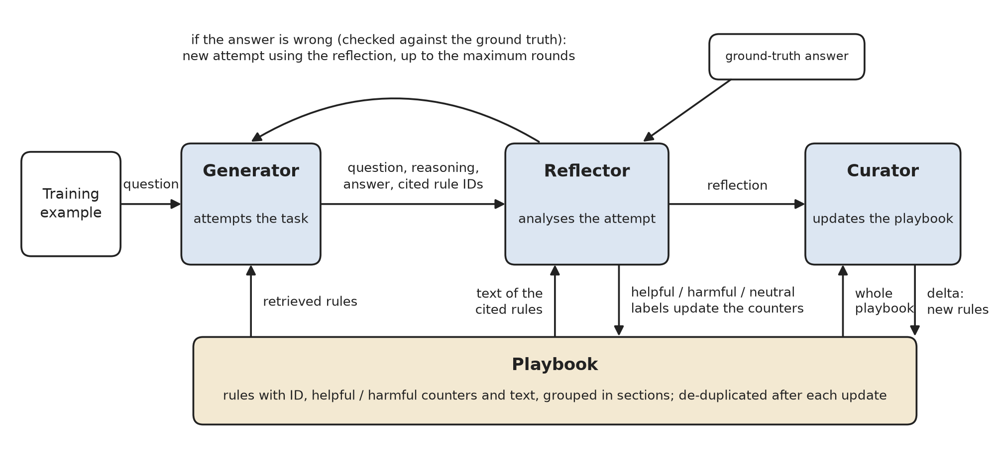
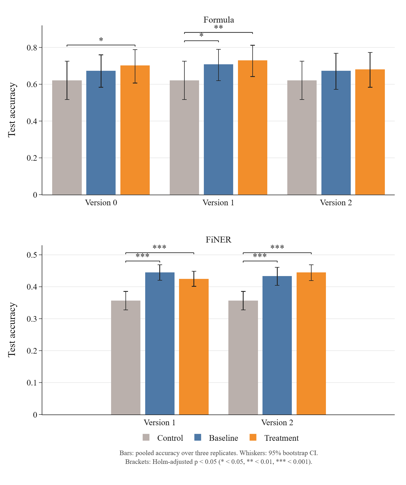
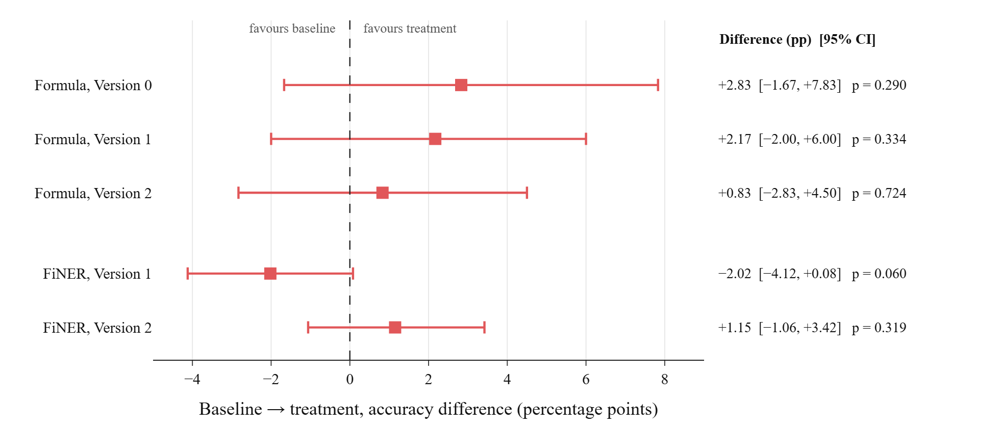

# Graph-structured vs flat memory for self-improving agents

A fork of [ACE (Agentic Context Engineering)](https://arxiv.org/abs/2510.04618) built to answer
one question:

> **Does storing an agent's learned rules as a graph, and following its edges at retrieval, give
> better task performance than the same kind of rules held as a flat list?**

**Short answer:** memory helps, by 5 to 11 accuracy points. Graph structure showed no detectable
benefit over the flat list in any of five experiments, although the graph verifiably changed what
the model read in every run. The designs can only rule out large effects, so a small advantage
remains possible.

## The loop

ACE lets an LLM improve without touching its weights. A **generator** attempts the task, a
**reflector** analyses the attempt and labels the rules it used, and a **curator** writes new rules
into a playbook that is retrieved into later prompts.



This fork keeps the loop and swaps only the memory object behind it.

## The three arms

| arm | memory | retrieval | what it answers |
|---|---|---|---|
| **control** | empty | none | does memory help at all? |
| **baseline** | flat list of rules | top rules by cosine similarity to the question | the ACE-style memory |
| **treatment** | same kind of rules, plus edges | same top rules as seeds, then a walk along the edges | does *structure* help? |

Both memory arms share the model, prompts, data order, de-duplication rule and one retrieval token
budget. The control carries the identical prompt with the memory slot empty.

## Three versions of the treatment

| version | edge between two rules | walk | tested on |
|---|---|---|---|
| **0** similarity | cosine similarity of their texts ≥ 0.6 | breadth-first | Formula |
| **1** gated co-citation | shown together ≥ 3 times and cited together in ≥ 20% (Formula) or 10% (FiNER) of those | breadth-first | Formula, FiNER |
| **2** ranked co-citation | each rule keeps its 2 strongest partners by `reward / (times shown together + 10)`, where reward counts correct answers | best-first on path strength; edges no longer printed in the prompt | Formula, FiNER |

Version 0 was abandoned as a test of the question: a similarity edge can be recomputed from the two
rules' texts, so a flat list could reproduce it without storing anything. Co-citation (which rules
the generator cited together) exists only in the run's history. Version 2 fixes a defect measured
in Version 1, where the walk could reach only 13–24% of the memory.

## Settings

| | |
|---|---|
| model | `gemma4:e2b` (about 2.3B effective parameters) in all three roles, temperature 0, generator reasoning off, context window pinned at 32,768 |
| loop | 1 epoch, up to 3 reflection rounds, curator after every example, offline adaptation |
| retrieval | 2,500-token budget, 5 seed rules, `all-mpnet-base-v2` encoder |
| de-duplication | embedding similarity, threshold 0.88 (Formula) and 0.86 (FiNER), identical in both memory arms |
| **Formula** | financial calculations; 250 train / 100 validation / 200 test (50 formulas × 4); exact numeric match |
| **FiNER** | XBRL tagging, 4 tags per row from a 139-tag list; 200 train / 150 validation / 441 test; per-tag accuracy |
| replicates | 3 runs per arm per experiment |
| inference | paired cluster sign-flip permutation test and cluster bootstrap CI (clusters: formulas on Formula, rows on FiNER), Holm correction over the three comparisons of each task |

Each experiment was pre-registered in `docs/` before its runs, with a dated deviation log.

## Results



**Memory against no memory** (accuracy gain over the control, percentage points):

| experiment | baseline | treatment |
|---|---|---|
| Formula, Version 0 | +5.17 (n.s.) | **+8.00** |
| Formula, Version 1 | **+8.67** | **+10.83** |
| Formula, Version 2 | +5.17 (n.s.) | +6.00 (n.s.) |
| FiNER, Version 1 | **+8.84** | **+6.82** |
| FiNER, Version 2 | **+7.65** | **+8.81** |

Bold is significant after Holm correction.

**Graph against flat list** (the primary comparison):



None of the five is significant. The intervals exclude a graph advantage larger than about
4.5–7.8 points on Formula and 3.4 points on FiNER; anything smaller is below what these designs can
detect.

### Was the treatment delivered?

A null means little if the graph never changed the prompt, so each run was checked before its
accuracy was read. *Walk-only share* is the fraction of rules shown that relevance alone would not
have selected. *Citation ratio* is how often the generator cited those rules relative to the
relevance-selected ones.

| experiment | rules with an edge | walk-only share | citation ratio | graph − flat (pp) |
|---|---|---|---|---|
| Formula, Version 0 | 90–92% | 0.09–0.21 | 0.67–0.86 | +2.83 |
| Formula, Version 1 | 16–24% | 0.05–0.45 | 1.25–2.32 | +2.17 |
| FiNER, Version 1 | 13–14% | 0.11–0.14 | 1.32–1.55 | −2.02 |
| Formula, Version 2 | 45–48% | 0.46–0.55 | 0.40–0.61 | +0.83 |
| FiNER, Version 2 | 47–48% | 0.55–0.56 | 0.16–0.20 | +1.15 |

Reach, dose and usage all moved a lot between versions. Accuracy barely moved.

## Limitations

- **One small model.** A 2B model may be unable to combine related rules, which is what a graph
  offers. The null may be a property of the model.
- **Limited power.** Effects of the size observed (−2 to +3 points) sit below the detection limits.
- **Replicates are not all independent.** Runs at temperature 0 sometimes come out byte-identical,
  so run-to-run noise is underestimated; every such case is disclosed in the results files.

## Running

```bash
uv sync    # Python 3.12
```

The LLM backend is an OpenAI-compatible Ollama endpoint. It defaults to a local server
(`http://localhost:11434/v1`); set `ACE_BASE_URL` to point elsewhere.

```bash
COMMON="--task_name formula --config_path ./eval/finance/data/task_config_v2.json \
  --generator_model gemma4:e2b --reflector_model gemma4:e2b --curator_model gemma4:e2b \
  --think_generator off --num_ctx 32768 --seed 0 --dedup --dedup_threshold 0.88 --eval_steps 125"

# control
uv run python -m eval.finance.run $COMMON --mode eval_only --memory none --retrieval none \
  --save_path results/demo/none

# baseline
uv run python -m eval.finance.run $COMMON --mode offline --memory text --retrieval flat \
  --skip_initial_test --save_path results/demo/text

# treatment (Version 1)
uv run python -m eval.finance.run $COMMON --mode offline --memory graph --retrieval graph \
  --cocite --cocite_min_opportunity 3 --cocite_min_rate 0.20 \
  --skip_initial_test --save_path results/demo/cocite
```

The exact commands of every experiment, including Version 2 and FiNER, are in its
pre-registration. Checks that need no network, worth running first:

```bash
uv run python check_memory_equivalence.py   # the flat arm matches the upstream code path
uv run python check_finance_wiring.py       # the whole loop, with the LLM stubbed
uv run python compare_arms.py --selftest    # the statistics, against known answers
```

Analysis of finished runs:

```bash
uv run python compare_arms.py <run_dir> ...           # paired, clustered cross-arm tests
uv run python analyze_walk_share.py <graph_run_dir>   # walk-only share and citation ratio
uv run python aggregate_run_costs.py <run_dir> ...    # tokens, time, and a fairness audit
```

## Documents

| experiment | pre-registration | results |
|---|---|---|
| Formula, Version 0 | [`EXPERIMENT_FORMULA.md`](docs/background/EXPERIMENT_FORMULA.md) | [`FORMULA_RESULTS_PREREGISTERED.md`](docs/background/FORMULA_RESULTS_PREREGISTERED.md) |
| Formula, Version 1 | [`EXPERIMENT_COCITE.md`](docs/EXPERIMENT_COCITE.md) | [`COCITE_RESULTS.md`](docs/COCITE_RESULTS.md) |
| FiNER, Version 1 | [`EXPERIMENT_FINER.md`](docs/EXPERIMENT_FINER.md) | [`FINER_RESULTS.md`](docs/FINER_RESULTS.md) |
| Version 2, both tasks | [`EXPERIMENT_COCITE_V2.md`](docs/EXPERIMENT_COCITE_V2.md) | [`RESULTSV2.md`](docs/RESULTSV2.md) |

[`STATS_VALIDATION.md`](docs/STATS_VALIDATION.md) records how the statistical code was checked
against known answers and standard libraries.

## Credit

Upstream method and prompts: Qizheng Zhang et al., *Agentic Context Engineering: Evolving Contexts
for Self-Improving Language Models* (arXiv:2510.04618), and the
[`ace-agent/ace`](https://github.com/ace-agent/ace) implementation. This fork is not a replication
of that paper: the model, training length and several settings differ, so absolute accuracies are
not comparable with theirs.
